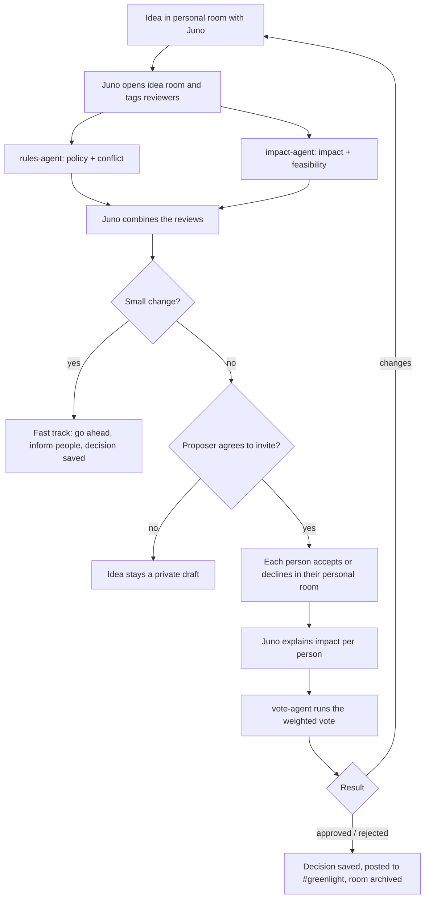

# Greenlight

**Demo video (2 min):** https://youtu.be/Yquy1DtvqGM  ·  **Blog post:** [docs/blog](docs/blog/README.md)

Idea management where agents review proposals and the affected people decide together. Built on [Switch](https://github.com/sandbox-quantum/switch) for the Flip the Switch Hackathon (WeMakeDevs × DevTools Academy × Switch), Track 01: Best Business Workflow.

A person refines an idea privately with Juno, their personal agent. Two review agents check it for **policy**, **conflicts**, **impact** and **feasibility**. With the proposer's permission, the affected people are invited to an idea room, where Juno explains how the change affects each of them. They vote, and the decision is saved to the main project.

> Status: working end to end on our Slack workspace (four agents on a self-hosted Switch server on a Google Cloud VM). Design brief: [docs/KICKOFF.md](docs/KICKOFF.md).

## The problem

Someone has an idea ("Can I add another payment gateway?"). They either build it and later find it breaks a policy or clashes with someone's work, or they ask around in DMs and meetings and the decision gets lost. There's no quick way to check an idea against rules, ongoing work, impact and effort, and then get the right people to agree.

## How it works



## Agents

- **juno** (Claude Code): front door. Shapes the idea in private, opens idea rooms, combines reviews, asks for consent, explains per-person impact. See [agents/juno.md](agents/juno.md)
- **rules-agent** (Claude Code): policy + conflict review. See [agents/rules-agent.md](agents/rules-agent.md)
- **impact-agent** (OpenCode with a Claude model): impact + feasibility review. See [agents/impact-agent.md](agents/impact-agent.md)
- **vote-agent** (Claude Code): typed weighted vote, decision record, closes the room. See [agents/vote-agent.md](agents/vote-agent.md)

## Rooms

- **Personal room** (`dm-<user>-juno`): one person + Juno, private
- **Idea room** (`idea-<id>-<slug>`): proposer + people who accepted + the agents, one per idea
- **Common room** (`#greenlight`): decisions and history for the whole project

## How Switch is used

- Rooms on Slack, created and archived by agents (`create_room`, `add_users_to_room`, `archive_room`)
- Agents as teammates that hand work to each other by name, visibly in the idea room
- Two agent runtimes side by side (Claude Code and OpenCode)
- Switch provides rooms, identities, the Slack bridge and room history. We built the workflow: consent invites, reviews, weighted voting and decision records.
- Chat feel: an agent marks your message with 👀 when it starts, answers in the channel, and keeps its work log ("Worked for Ns") in the thread. We hid Switch's session-start notice for this (`scripts/hide-session-start-notice.sh`)

## Demo company

Ideas are reviewed against [Parcelwise](https://github.com/codebreaker32/parcelwise), a demo company repo with stub code, `CODEOWNERS`, a team directory, policies, ongoing projects and an open PR. Aman and Bhawna are real; Dev, Riya and Alex are fictional. Sample ideas: [docs/SAMPLE_IDEAS.md](docs/SAMPLE_IDEAS.md).

## Voting

Weighted by impact and seniority, with a fast path for small changes. See [docs/VOTING.md](docs/VOTING.md). Decisions are saved as [decisions/](decisions/) files ([format](docs/DECISION_FORMAT.md)).

## Setup

What you need: a Linux VM (we use Google Cloud e2-standard-4, Ubuntu 24.04), a Slack workspace where you can create apps, Switch Console on your laptop, Claude Code and OpenCode on the VM. Full notes and every gotcha we hit: [docs/SWITCH_NOTES.md](docs/SWITCH_NOTES.md).

1. **Switch server on the VM.** In Switch Console, add the VM as a remote host over SSH and install the server. It runs as Docker containers (gateway, switch-core, Mattermost, Postgres). So they come back after a reboot: `docker update --restart unless-stopped $(docker ps -q --filter name=switchdash-remote)`.
2. **Slack.** Create a Slack app from Switch's manifest (Socket Mode). Give Switch the app token (`xapp-`, scope `connections:write`) and, after *Install to Workspace*, the bot token (`xoxb-`).
3. **Tools on the VM.** Install Claude Code and OpenCode, sign in (`claude`, `opencode auth login`), and put both on PATH for non-login shells: `sudo ln -sf ~/.local/bin/claude /usr/local/bin/claude` (same for `opencode`). Also `gh auth login` so vote-agent can push decisions.
4. **Repos on the VM.**
   ```bash
   git clone https://github.com/codebreaker32/greenlight ~/work/greenlight
   git clone https://github.com/codebreaker32/parcelwise ~/work/demo/parcelwise
   ```
5. **Agents.** In Switch Console create four agents with *Run location* = your VM and *Who can talk to your agent* = Anyone: `juno`, `rules-agent`, `vote-agent` (Claude Code) and `impact-agent` (OpenCode, Claude model). Folders: `~/work/agents/<name>`. Set up each agent's instruction file as described in [agents/README.md](agents/README.md); after every `git pull`, `scripts/sync-agent-roles.sh` refreshes the role text. Or load [templates/greenlight.template.yaml](templates/greenlight.template.yaml).
6. **Keep agents online after a reboot.** `scripts/install-controller-service.sh` installs Switch's agent controller as a systemd user service (needs `sudo loginctl enable-linger $USER`).
7. **Optional chat polish.** `scripts/hide-session-start-notice.sh` removes Switch's "starting a session" line so people see 👀, then the answer. Re-run it after a Switch server update.
8. **Channel.** Create `#greenlight` in Slack and invite the four agents. That is the common room for decisions.

## Try it

In `#greenlight`, type:

> @juno can we add a weekly payout summary email for Finance? Dev reconciles payouts by hand every Monday

Juno opens your private room (`dm-<you>-juno`), asks a question or two and shows a summary. Say yes and it opens `idea-<id>-<slug>` with the reviewers. After the reviews, the affected people get a private invite and type `accept`, Juno explains the impact per person, and vote-agent runs the vote (`@vote-agent vote approve`, `reject: <reason>` or `changes: <what>`). The decision lands in [decisions/](decisions/) and in `#greenlight`. Step-by-step demo: [docs/DEMO_SCRIPT.md](docs/DEMO_SCRIPT.md). A small, safe change (like a typo fix) is fast-tracked without a vote.

## Limits

- No scheduler: votes close on a message, not on a timer
- Agents can't see emoji reactions, so every vote is typed
- Slack users are looked up by username, not email
- The agent controller on the VM must be running (installed as a boot service: `scripts/install-controller-service.sh`); Switch Console is only needed to create or change agents
- The session-start line is customised by patching the Switch server (`scripts/patch-session-message.sh`); a fresh Switch install shows Switch's default text
- Demo data is a made-up company repo (Parcelwise), not a real company system
