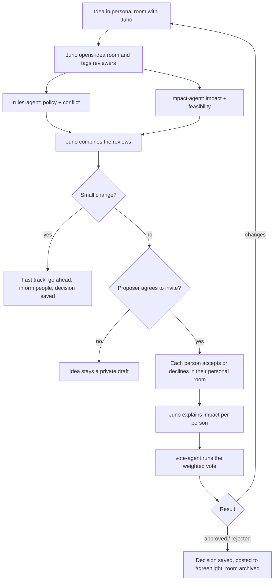

# Greenlight

Idea management where agents review proposals and the affected people decide together. Built on [Switch](https://github.com/sandbox-quantum/switch) for the Flip the Switch Hackathon (WeMakeDevs × DevTools Academy × Switch), Track 01: Best Business Workflow.

A person refines an idea privately with Juno, their personal agent. Two review agents check it for **policy**, **conflicts**, **impact** and **feasibility**. With the proposer's permission, the affected people are invited to an idea room, where Juno explains how the change affects each of them. They vote, and the decision is saved to the main project.

> Status: setup in progress. See [docs/KICKOFF.md](docs/KICKOFF.md) for the full design brief and the open issues for current work.

<!-- Outline below (issue #2). Sections marked TODO are filled in during implementation. -->

## The problem

Someone has an idea ("Can I add another payment gateway?"). They either build it and later find it breaks a policy or clashes with someone's work, or they ask around in DMs and meetings and the decision gets lost. There's no quick way to check an idea against rules, ongoing work, impact and effort, and then get the right people to agree.

## How it works

## Agents

- **juno** (Claude Code): front door. Shapes the idea in private, opens idea rooms, combines reviews, asks for consent, explains per-person impact. See [agents/juno.md](agents/juno.md)
- **rules-agent** (Claude Code): policy + conflict review. See [agents/rules-agent.md](agents/rules-agent.md)
- **impact-agent** (OpenCode with a Claude model): impact + feasibility review. See [agents/impact-agent.md](agents/impact-agent.md)
- **vote-agent** (Claude Code): typed weighted vote, decision record, closes the room. See [agents/vote-agent.md](agents/vote-agent.md)

## Rooms

- **Personal room** (`dm-<user>-juno`): one person + Juno, private
- **Idea room** (`idea-<id>-<slug>`): proposer + people who accepted + the agents, one per idea
- **Common room** (`#greenlight`): decisions and history for the whole project

## How Switch is used

- Rooms on Slack, created and archived by agents (`create_room`, `add_users_to_room`, `archive_room`)
- Agents as teammates that hand work to each other by name, visibly in the idea room
- Two agent runtimes side by side (Claude Code and OpenCode)
- Switch provides rooms, identities, the Slack bridge and room history. We built the workflow: consent invites, reviews, weighted voting and decision records. TODO: add screenshots

## Voting

Weighted by impact and seniority, with a fast path for small changes. See [docs/VOTING.md](docs/VOTING.md). Decisions are saved as [decisions/](decisions/) files ([format](docs/DECISION_FORMAT.md)).

## Setup

TODO: step-by-step from [docs/SWITCH_NOTES.md](docs/SWITCH_NOTES.md):
1. VM + Switch server via Switch Console (remote host)
2. Slack app from Switch's manifest
3. Register the 4 agents (or load [templates/greenlight.template.yaml](templates/greenlight.template.yaml))
4. Clone this repo to `~/work/greenlight` on the VM
5. Try it: [docs/DEMO_SCRIPT.md](docs/DEMO_SCRIPT.md)

## Limits

- No scheduler: votes close on a message, not on a timer
- Agents can't see emoji reactions, so every vote is typed
- Slack users are looked up by username, not email
- The Switch Console desktop app must be open for agents to start sessions
- Demo data is sample files, not a real company system
