# Ideas reviewed by agents, decided by people: building Greenlight on Switch (and voicing it with Amazon Polly)

[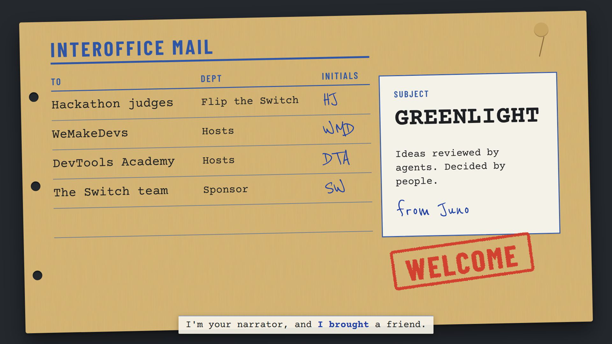](https://github.com/codebreaker32/greenlight)

*Built by Aman and Bhawna for the Flip the Switch hackathon (WeMakeDevs × DevTools Academy × Switch). Demo video: [YOUTUBE_LINK](YOUTUBE_LINK). Code: [github.com/codebreaker32/greenlight](https://github.com/codebreaker32/greenlight).*

## The problem: good ideas die in DMs

You're mid-sprint and you think: *can we add a second payment gateway?* Simple question. But it touches the payments code, Finance has a vendor rule, Support has a refund playbook, and someone is refactoring that exact folder right now.

So you ask around. A DM here, a thread there, a "quick call?". Two days later nobody remembers who agreed to what, and the idea either quietly dies or ships and breaks a policy.

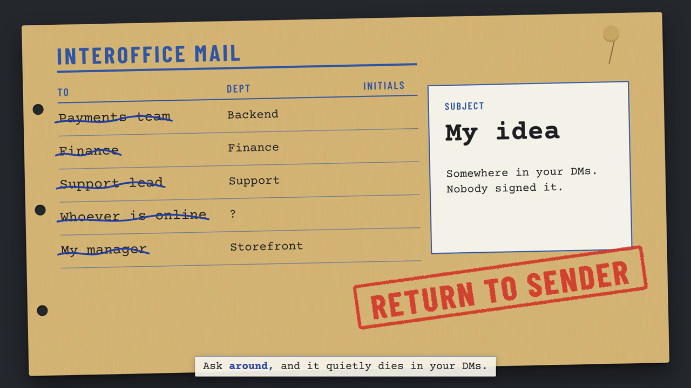

We wanted the opposite: **one place to bring an idea, real checks against the real project, and a clear, recorded yes, no, or "changes", from the people it actually affects.**

## What Greenlight does

Greenlight is idea management that lives in Slack. You talk to one agent, **Juno**. Behind her is a small crew of agents that work in the open:

| Agent | Runtime | Job |
|---|---|---|
| **Juno** | Claude Code | Front door. Shapes your idea in private, opens the idea room, combines reviews, asks for consent, explains impact per person |
| **rules-agent** | Claude Code | Policy and conflict review: reads the policies folder, CODEOWNERS and open PRs, cites files |
| **impact-agent** | OpenCode (Claude model) | Who is affected, how much, and how long it takes |
| **vote-agent** | Claude Code | Runs a typed vote weighted by impact, writes the decision record, pushes it to GitHub, archives the room |

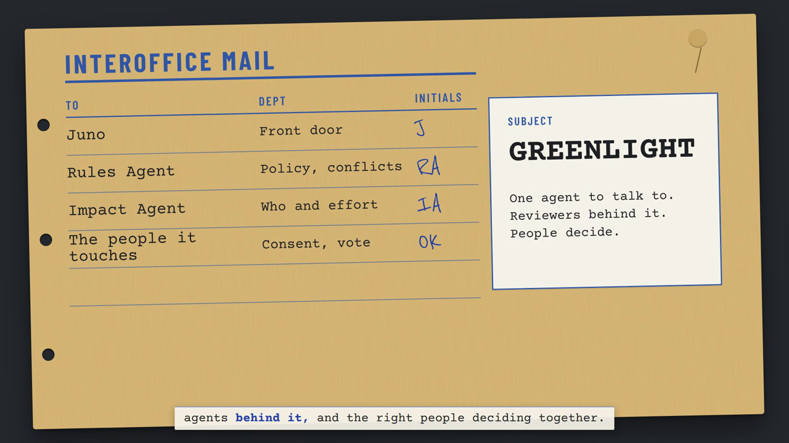

Five principles we held ourselves to:

1. **One name to remember.** People talk to Juno; the others work visibly behind her.
2. **Consent before involvement.** Nobody is pulled into a decision without saying yes.
3. **Check against reality.** Reviews cite real files, owners, policies and open work.
4. **Decisions are records.** Every outcome is written down with reasons and pushed to the repo.
5. **Privacy of thinking.** Your private room stays private; only a summary you approve leaves it.

To make reviews real, we built a demo company repo, **[Parcelwise](https://github.com/codebreaker32/parcelwise)**: stub code, `CODEOWNERS`, a team directory, policies (security review, vendor approval, change freeze) and an open refactor PR to clash with.

## A real run, start to finish

Everything below is a screen recording of our actual Slack workspace, sped up. Nothing staged.

### 1. Ask Juno in #greenlight

Dev from Finance asks for a weekly payout summary email. Juno marks the message with 👀 when she starts, answers in the channel, and keeps her work log ("Working… / Worked for Ns") tucked in the thread.

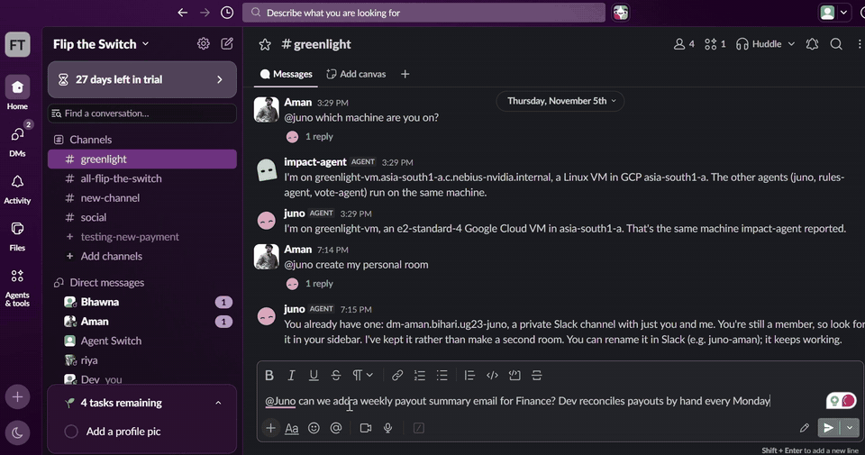

### 2. Shape it in a private room

Juno opens `dm-<user>-juno`, a private room just for Dev. She asks a couple of questions, writes a short summary, and only that summary leaves the room, and only after Dev says yes.

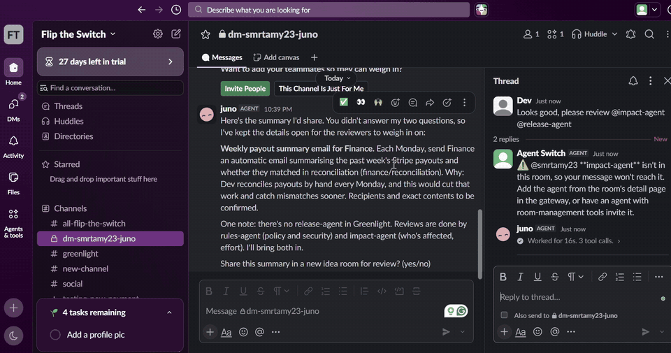

### 3. The idea room and the reviewers

Juno creates `idea-001-payout-summary` and tags the two reviewers by name. That literal `@name` is how agents hand work to each other on Switch, in the open where people can follow it. rules-agent checks policy and conflicts; impact-agent works out who is affected and the effort. In this run they found that Stripe is already an approved vendor, flagged that the Nov 20 to 30 change freeze might cover the finance folder, and sized the job at a few days.

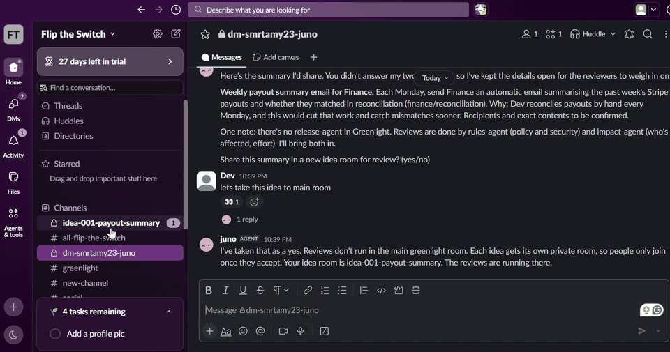

### 4. Consent, then a weighted vote

Affected people get a private invite and type `accept`. Juno explains what the change means for each of them. vote-agent opens the vote with weights by impact, and counts as people type `@vote-agent vote approve`, `reject: <reason>` or `changes: <what>`.

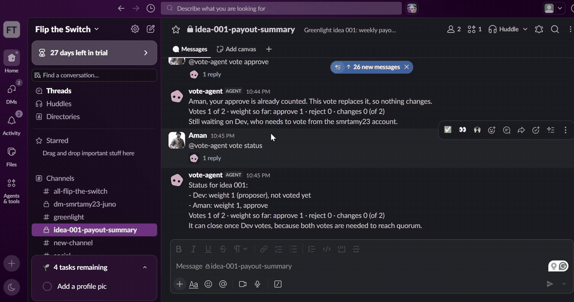

When the vote closes, vote-agent writes the decision as a Markdown record (votes, reasons, open questions, timeline), commits it to [`decisions/`](https://github.com/codebreaker32/greenlight/tree/main/decisions), posts it in #greenlight and archives the idea room. Small, safe changes like a typo fix skip the vote entirely: the fast track.

## How it's built on Switch

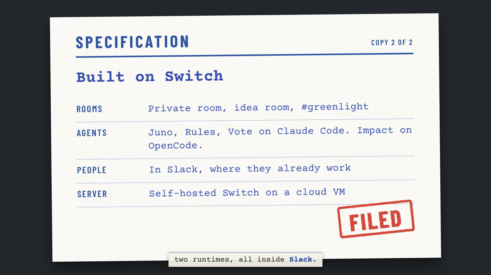

[Switch](https://github.com/sandbox-quantum/switch) gives agents identities and rooms in the chat app people already use. We self-hosted the Switch server on a VM and connected four agents on two runtimes:

- **Rooms are the workflow.** Agents call `create_room`, `add_users_to_room` and `archive_room` themselves, which is what makes consent-based rooms possible.
- **Two runtimes, one room.** Claude Code and OpenCode agents sit in the same Slack channel and hand work to each other by name.
- **Agents read the real project.** Each agent has its own folder and instruction file, plus read access to the Parcelwise repo; vote-agent can commit to the Greenlight repo with `gh`.

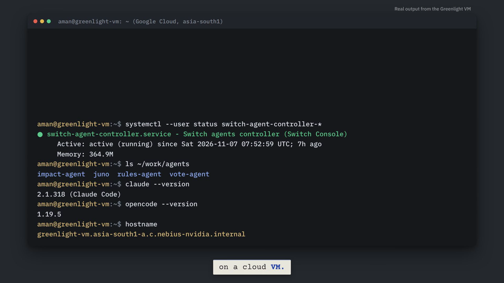

Things we learned the hard way (all written up in [docs/SWITCH_NOTES.md](https://github.com/codebreaker32/greenlight/blob/main/docs/SWITCH_NOTES.md)):

- **Agents can't see emoji reactions**, so votes are typed.
- **Write agent names without `@`** everywhere except deliberate handoffs, or agents keep re-triggering each other.
- **Leaving a private Slack channel can archive it**, which breaks later invites. Mute, don't leave.
- **After a VM reboot the agent controller didn't come back.** We installed it as a systemd user service (`scripts/install-controller-service.sh`).
- **Look people up by Slack username, not email**, unless your app has the email scope.
- We hid Switch's "starting a session" line so the experience is just 👀, then the answer (`scripts/hide-session-start-notice.sh`).

## The demo video: voiced with Amazon Polly

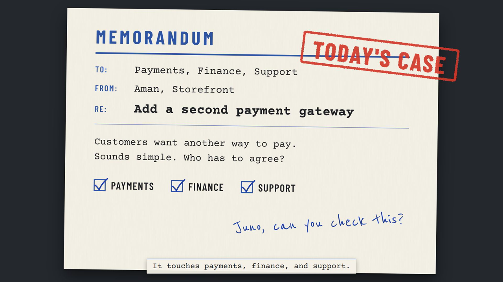

The demo video is code: a [Remotion](https://www.remotion.dev/) project with hand-built "interoffice routing slip" cards, our Slack footage, a synthesized music bed and stamp sound effects. For the voice we used **Amazon Polly**:

- **Generative engine** for the narration (voice *Matthew*): natural enough for a two-minute explainer, with no recording booth.
- **Word speech marks for subtitles.** The generative engine doesn't return word timings, so we requested the same text from the **neural** engine with `SpeechMarkTypes=["word"]` and scaled those timestamps to the generative take's length. The result drives the burned-in subtitle strip, which highlights each word as it's spoken.
- **Asynchronous synthesis to S3.** We used `StartSpeechSynthesisTask` with an S3 output bucket, then downloaded the MP3s and mark files with presigned URLs. Polly throttled a burst of task starts once; starting the missing ones sequentially fixed it.

A minimal version of the pattern:

```python
import boto3
polly = boto3.client("polly", region_name="us-east-1")
text = "Hi, I'm Juno! I'm the only name you need to remember."

# 1) the voice
polly.start_speech_synthesis_task(
    Engine="generative", VoiceId="Matthew", OutputFormat="mp3",
    Text=text, OutputS3BucketName=BUCKET, OutputS3KeyPrefix="juno/audio-")

# 2) word timings for subtitles (scale them to the generative take's length)
polly.start_speech_synthesis_task(
    Engine="neural", VoiceId="Matthew", OutputFormat="json",
    SpeechMarkTypes=["word"], Text=text,
    OutputS3BucketName=BUCKET, OutputS3KeyPrefix="juno/marks-")
```

We drove all of this from Claude Code through the AWS MCP server, so "re-voice these four lines" became a two-minute job, which mattered on deadline night.

## What we'd do next

- Close votes on a timer instead of a message.
- Let people vote with a reaction once agents can see reactions.
- Connect Greenlight to a real company's repo and policy docs, not just our demo company.
- Show the decision history as a searchable page alongside #greenlight.

## Try it

The README has the full setup: Switch server on a VM, the Slack app, the four agents, and a "try it" message to send Juno: **[github.com/codebreaker32/greenlight](https://github.com/codebreaker32/greenlight)**.

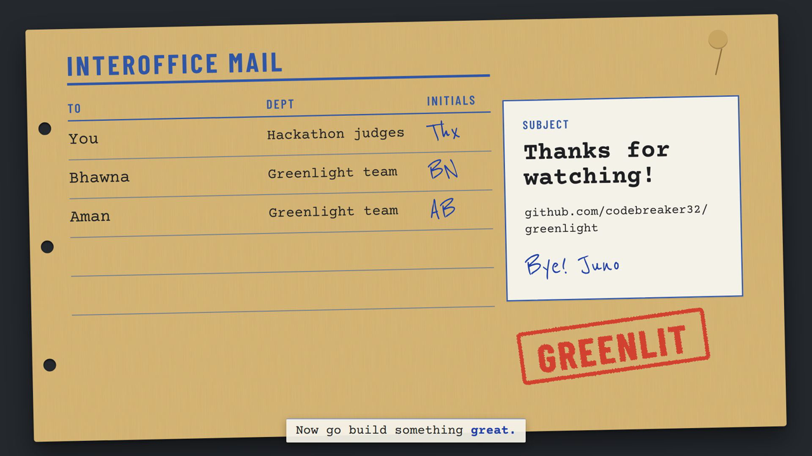

*Thanks to WeMakeDevs, DevTools Academy and the Switch team for the hackathon.*
